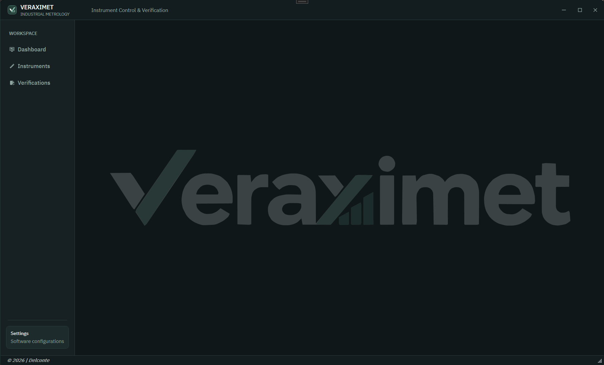
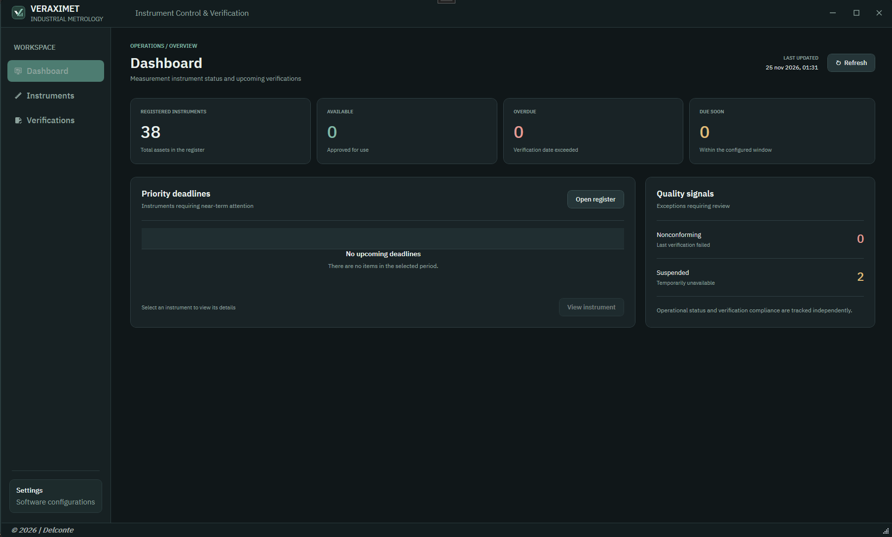
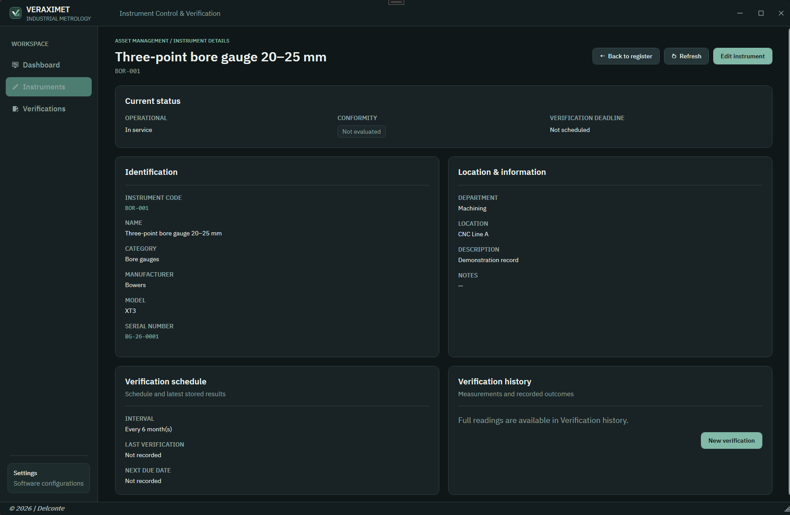
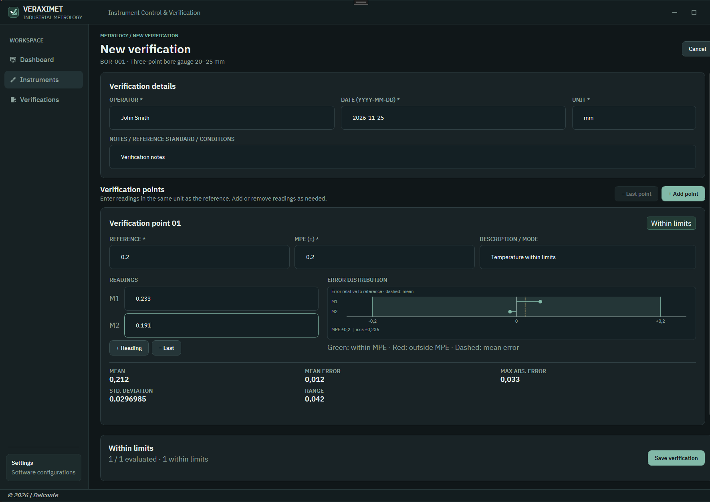
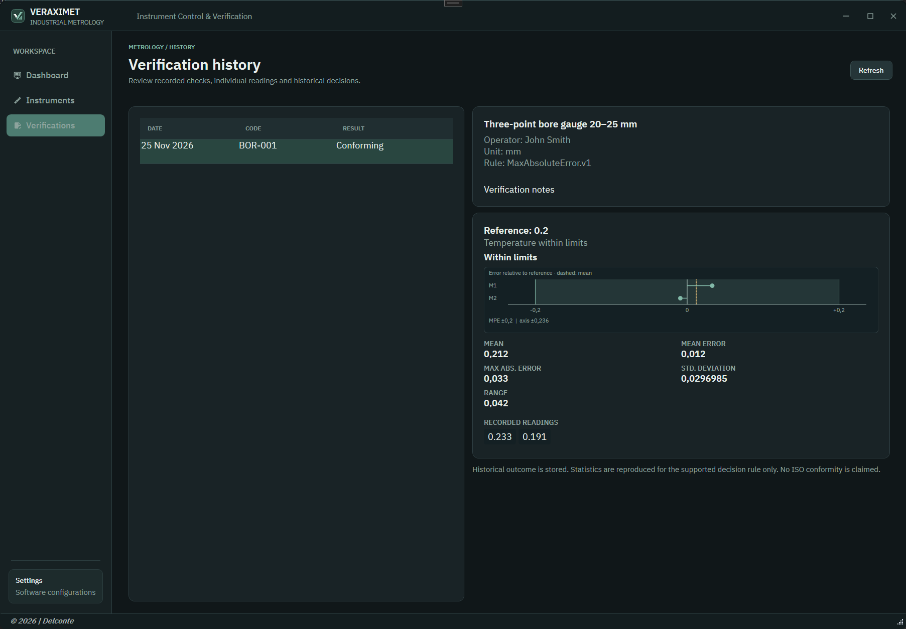

[](LICENSE)

<p align="center">
  
</p>

<h1 align="center">Veraximet</h1>

<p align="center">Measurement instrument management and metrological verification.</p>

Veraximet is a desktop application for managing measurement instruments in industrial environments. It brings together instrument records, verification schedules, measurement data and historical results in a single workspace.

The goal is to make verifications reproducible and traceable, progressively distinguishing conformity to metrological specifications from an instrument's suitability for a specific manufacturing process.

## Features

- **Dashboard:** overview of instrument status and upcoming verification dates.
- **Instrument register:** identification, classification, search and editing, including location and operational status management.
- **Verification:** entry of multiple test points, reference values, MPE limits and repeated readings.
- **Measurement analysis:** mean, mean error, maximum absolute error, range and sample standard deviation.
- **Visualization:** plot of individual errors relative to the reference and tolerance limits.
- **History:** retention of verifications, original readings, decision rules and outcomes.
- **Scheduling:** calculation of the next verification date based on the outcome and configured interval.

> [!IMPORTANT]
> Veraximet is currently under active development. Its metrological algorithms have not yet undergone formal validation against applicable ISO standards. Measurement results and conformity assessments must be independently verified before being used for production acceptance, safety-critical decisions, or regulatory compliance.
---
## Preview
 

### Dashboard

 

### Instrument details

 

### Metrological verification



### Verification history

 

## Metrological model

The current version applies the `MaxAbsoluteError.v1` decision rule. For each verification point, the maximum absolute error of the readings is compared with the maximum permissible error (MPE) entered by the operator.

<b>Decision rule is in [METROLOGY](METROLOGY.html)</b>

This is a simple acceptance rule: it does not yet account for measurement uncertainty, metrological traceability of reference standards, guard bands or the completeness of a normative procedure. The result alone does not constitute an ISO conformity statement or a calibration certificate.

The [Metrology and calculations](METROLOGY.html) document describes the current algorithm, formulas, edge cases and possible model for future extensions.

## Solution structure

```text
Veraximet.sln
├── Veraximet/                 WPF application, view models and navigation
├── Veraximet.UI/              Visual assets, styles and UI components
├── Veraximet.Domain/          Entities, states and domain rules
├── Veraximet.Contracts/       DTOs and service contracts
├── Veraximet.Infrastructure/  SQLite persistence and application services
└── Veraximet.Metrology/       Calculations and decision rules
```

The metrology engine is independent of the graphical interface. View models use the calculator to preview results; the application service recalculates the outcome from the original readings before persistence.

The application uses C#, .NET 8, WPF, MVVM, Entity Framework Core and SQLite. Beautify provides UI components, `WindowService`, `NavigationService` and MVVM primitives. Windows are managed through the former, and UserControl views through the latter.

## Building and running

### Requirements

- Windows and the .NET 8 SDK.
- Visual Studio with the **.NET desktop development** workload, or the .NET CLI.
- Compatible Beautify DLLs and their dependencies, which are not included in the solution archive.
- Access to the NuGet sources required for package restoration.

From the directory containing `Veraximet.sln`, configure the path to the Beautify DLLs:

```powershell
$env:BeautifyPath = 'C:\Path\To\Beautify\bin\Release\net8.0-windows'

dotnet restore Veraximet.sln
dotnet build Veraximet.sln -c Debug
dotnet run --project Veraximet/Veraximet.csproj
```

Alternatively, open `Veraximet.sln` directly in Visual Studio. 

## Database

Veraximet uses a local SQLite database. The default location is:

```text
%LOCALAPPDATA%\Veraximet\veraximet.db
```

EF Core migrations are applied automatically at startup. To use a separate database, set `VERAXIMET_DB_PATH` before launching the application. To generate sample instrument records:

```powershell
$env:VERAXIMET_DB_PATH = "$env:TEMP\veraximet-demo.db"
dotnet run --project Veraximet/Veraximet.csproj -- --seed-demo
```

The seeder does not insert duplicate instrument codes. Back up the database before upgrading an existing installation.

## Project status and roadmap

Veraximet is under development. Instrument management and basic verification calculations are present in the source code. Planned metrological extensions include:

- [ ] Type A and Type B uncertainty budgets, uncertainty propagation and coverage factors.
- [ ] Guard-band decision rules and indeterminate outcomes.
- [ ] Calibration certificates and reference standard management.
- [ ] Versioned specifications and instrument-family-specific procedures.
- [ ] Measurement system and process capability assessment, independent of conformity to specifications.
- [ ] Documented corrections, restrictions on use and MSA / Gage R&R studies.
- [ ] Engine validation through automated tests and normative reference cases.

The project's technical references include VIM (JCGM 200), GUM (JCGM 100), JCGM 106, ISO 10012, ISO/IEC 17025, ISO 14253-1 and ISO 22514-7. The use of these references does not constitute software certification.
## License

Veraximet is free and open-source software released under the [MIT License](LICENSE).

You are free to use, modify, distribute, and incorporate this software into personal, academic, or commercial projects, provided that the original copyright and license notices are preserved.

Copyright © 2026 Giulio Delconte.
